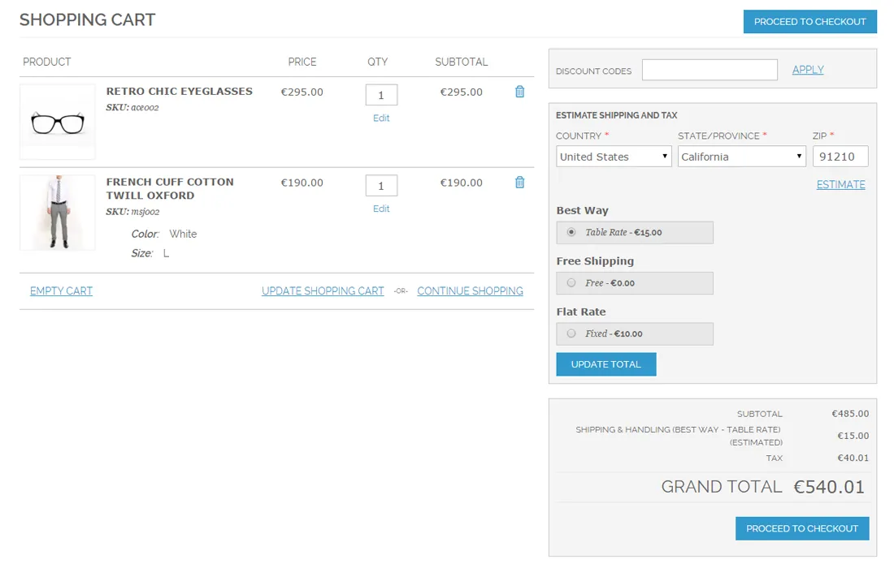
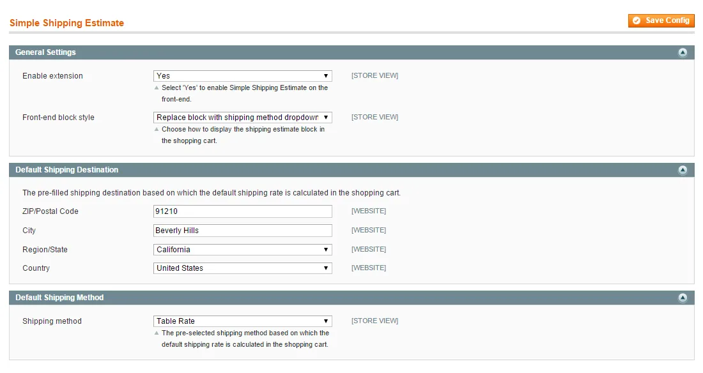

# Simple Shipping Estimate for Magento 1 / OpenMage

**Simpler shipping estimate blocks for the Magento shopping cart.**



Replaces the default shipping estimate form in the cart with a simpler block, or hides it.

Shows estimated shipping costs right away, based on a default destination and shipping method or the customer's default address. Suited to stores with few shipping destinations and methods.

> [!NOTE]
> Simple Shipping Estimate is free and open source under the MIT License (since 2026). Plugin Company no longer actively develops this extension, but issues and pull requests are welcome.

## Features

- Shows estimated shipping costs in the cart right away
- Three shipping estimate block layouts
- Default block with pre-filled destination and method
- Shipping method dropdown instead of the estimate form
- Option to hide the shipping estimate block
- Estimates based on the customer's default address
- Shows shipping costs before checkout

## Screenshots

<table>
  <tr>
    <td width="50%" valign="top"><br><sub>Simple Shipping Estimate configuration</sub></td>
    <td width="50%" valign="top"><br><sub>Replace block with shipping method drop-down</sub></td>
  </tr>
  <tr>
    <td width="50%" valign="top"><br><sub>Completely remove block</sub></td>
    <td width="50%"></td>
  </tr>
</table>

## Compatibility

- **Magento:** Community Edition 1.4.x – 1.9.x, Enterprise Edition 1.8.x – 1.14.x
- **Latest version:** 1.1.1 (released 2019-04-08)
- **Composer package:** `plugincompany/magento1-simple-shipping-estimate`
- **Module:** `Plugincompany_Simpleshippingestimate`

## Installation

### modman

```bash
cd /path/to/magento
modman init   # once per Magento installation
modman clone https://github.com/PluginCompany/magento1-simple-shipping-estimate.git
```

modman creates symlinks, so enable *Allow Symlinks* under System > Configuration > Advanced > Developer > Template Settings.

### Composer

With [magento-hackathon/magento-composer-installer](https://github.com/Cotya/magento-composer-installer) (it reads the `modman` file of this repository):

```bash
composer config repositories.plugin.company composer https://plugin.company/
composer require plugincompany/magento1-simple-shipping-estimate
```

Your project `composer.json` needs the Magento root directory in its `extra` section (and, with Composer 2.2+, the installer plugin allowed), for example:

```json
{
    "extra": { "magento-root-dir": "./" },
    "config": { "allow-plugins": { "magento-hackathon/magento-composer-installer": true } }
}
```

### Manual installation

Download the ZIP of the latest release from the [tags page](https://github.com/PluginCompany/magento1-simple-shipping-estimate/tags) ([1.1.1](https://github.com/PluginCompany/magento1-simple-shipping-estimate/archive/refs/tags/1.1.1.zip)) and copy the `app/` folder into your Magento root:

```bash
unzip magento1-simple-shipping-estimate-1.1.1.zip
cp -R magento1-simple-shipping-estimate-1.1.1/app /path/to/magento/
```

Step-by-step instructions are in the [installation guide](docs/02-installing-the-magento-extension.md).

### After installing

Clear the cache (System > Cache Management, or `rm -rf var/cache/*`), then log out of the admin and log in again so the new configuration sections and permissions are loaded.

### Upgrading from a purchased copy

Replace the old files with this release. No license key is needed; your settings and data stay as they are.

## Documentation

- [Documentation in this repository](docs/README.md) (Installation Guide, User Manual)
- Online documentation: <https://plugin.company/knowledge-base/docs/magento-simple-shipping-estimate/>
- Product page: <https://plugin.company/magento1-extensions/simple-shipping-estimate.html>

## Changelog

See [CHANGELOG.md](CHANGELOG.md) for the release history.

## Contributing

Found a bug or have an improvement? Please open an [issue](https://github.com/PluginCompany/magento1-simple-shipping-estimate/issues) or send a [pull request](https://github.com/PluginCompany/magento1-simple-shipping-estimate/pulls). Since the extension is no longer actively developed by Plugin Company, fixes from the community are the best way to keep it working on current Magento 1 / OpenMage and PHP versions.

## License

Plugin Company's code in this repository is released under the [MIT License](LICENSE), Copyright (c) 2014-2026 Plugin Company.

Bundled third-party libraries keep their own licenses; see [THIRD-PARTY-NOTICES.md](THIRD-PARTY-NOTICES.md) for the full list.

In particular:

- A few files are copies or adaptations of Magento core code and keep their original Magento license headers (OSL-3.0 / AFL-3.0).
