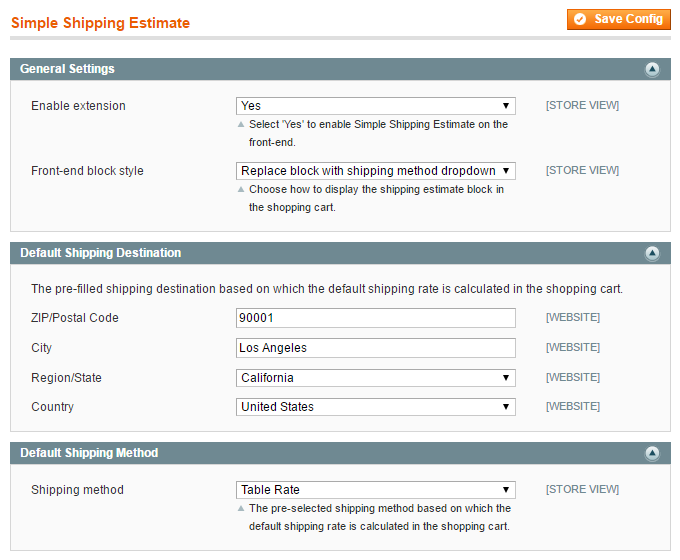

# Configuring the Simple Shipping Estimate Extension

To configure the extension, navigate to **System > Configuration** in the top Admin Panel menu and select **Simple Shipping Estimate** from the left side menu.

Using the config page you can enable the extension, choose a shipping estimation block layout and configure a default shipping destination and shipping method for instant shipping costs estimation in the customer's shopping cart.

It's possible to configure the extension per store view by changing the 'Current Configuration Scope' at the top left corner of the page.

To save any changes made in the Simple Shipping Estimate settings, click the 'Save Config' button in the top right corner of the configuration page.

## General Settings

Enable the extension to show the selected simple shipping estimation block in your front-end store.

You can choose from the following three simplified shipping estimation block layouts ([see front-end examples](./05-simple-shipping-estimate-frontend-examples.md)), which all directly show the estimated shipping costs in the shopping cart:

- **'Leave block as is'** uses Magento's default shipping estimate block, but shows a prefilled shipping address and preselected shipping method based on your default settings.
- **'Replace block with shipping method dropdown'** hides the address section and shows a shipping method dropdown menu, preselecting the default shipping method.
- **'Completely remove block'** hides the shipping estimation block and only shows the estimated shipping costs based on the default settings.

## Default Shipping Destination

At 'Default Shipping Destination' you can enter a default shipping address based on which the shipping costs are instantly estimated in the customer's shopping cart (it's not necessary complete all address fields).

If a customer is logged in, the extension will automatically estimate the shipping costs based on the customer's default shipping or billing address instead of using the default shipping destination entered in the config screen.

## Default Shipping Method

You can also select a default shipping method for the initial shipping costs estimation, choosing from your store's enabled shipping methods.

To configure your shipping methods, open the Shipping Methods tab in the left side Configuration menu.

---

[Documentation index](./README.md) · [README](../README.md) · [Online version](https://plugin.company/knowledge-base/docs/magento-simple-shipping-estimate/user-manual/configuring-the-simple-shipping-estimate-extension/)
