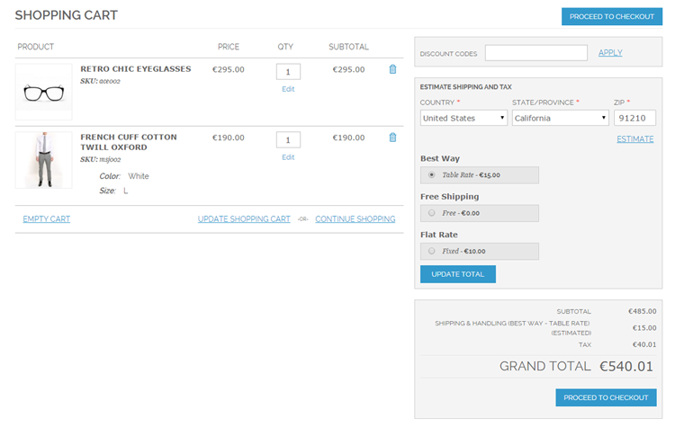
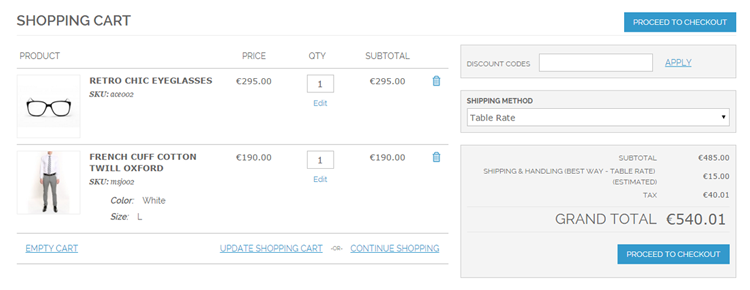
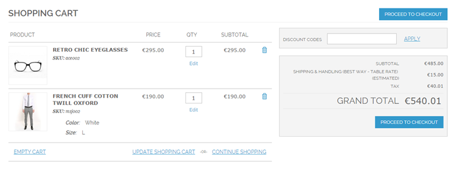

# Simple Shipping Estimate Front-end Examples

Below are front-end examples of the three simple shipping estimation block layouts, directly showing the estimated shipping costs in the shopping cart based on the default shipping address and method.

## Leave Block As Is

## Replace Block With Shipping Method Dropdown

## Completely Remove Block

---

[Documentation index](./README.md) · [README](../README.md) · [Online version](https://plugin.company/knowledge-base/docs/magento-simple-shipping-estimate/user-manual/simple-shipping-estimate-frontend-examples/)
